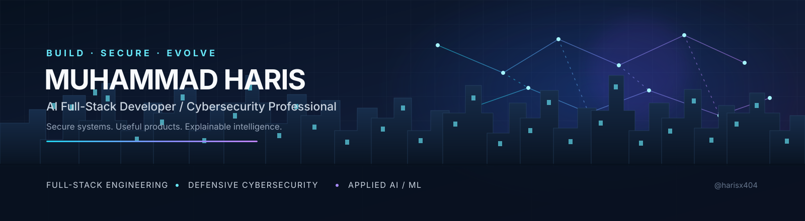
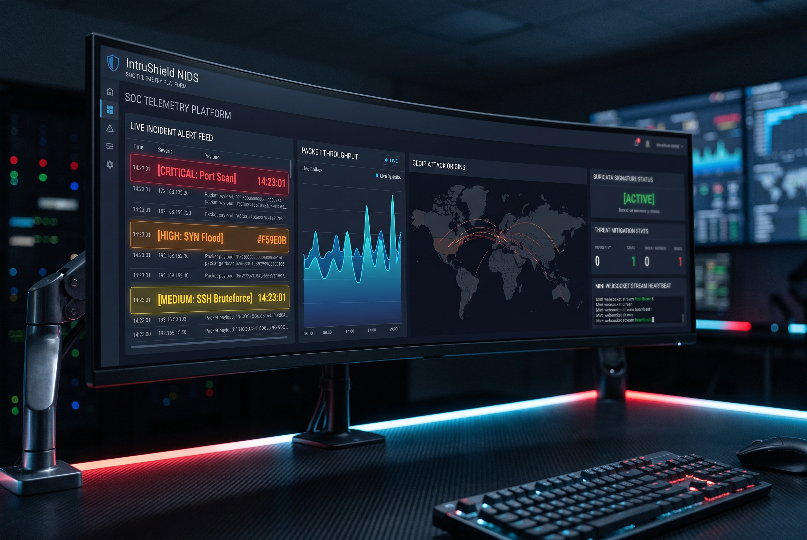
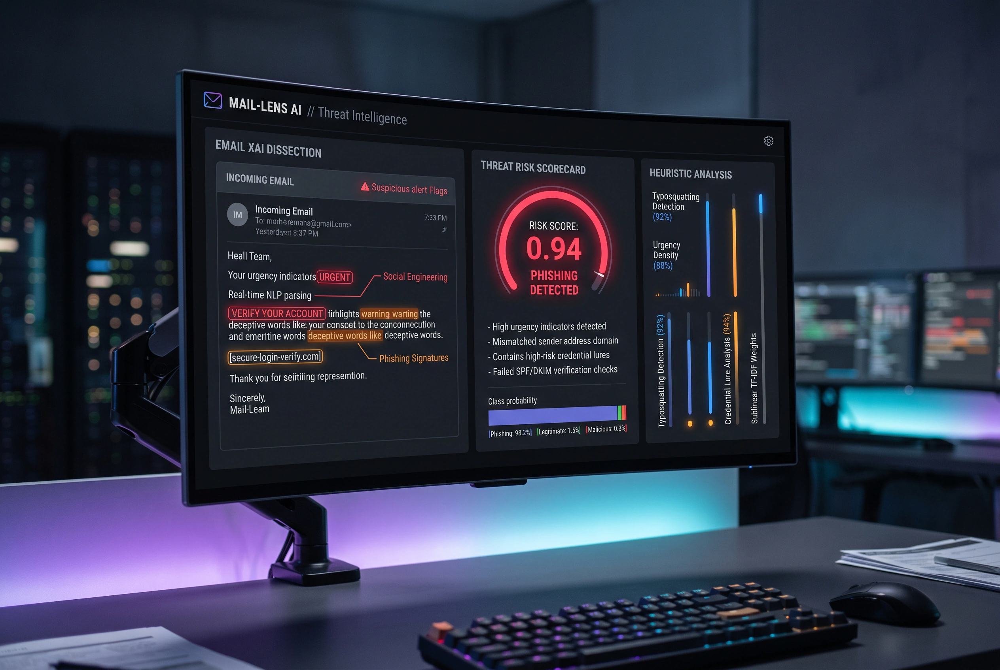
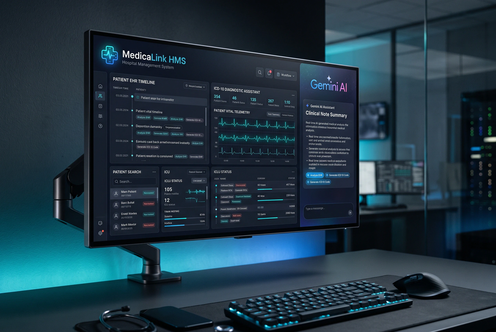
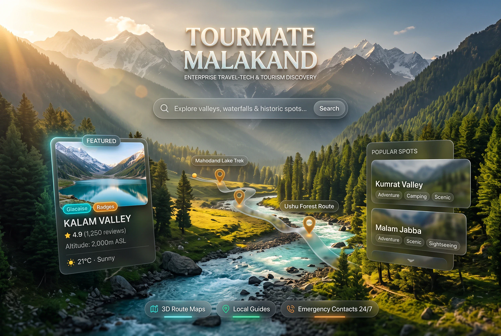
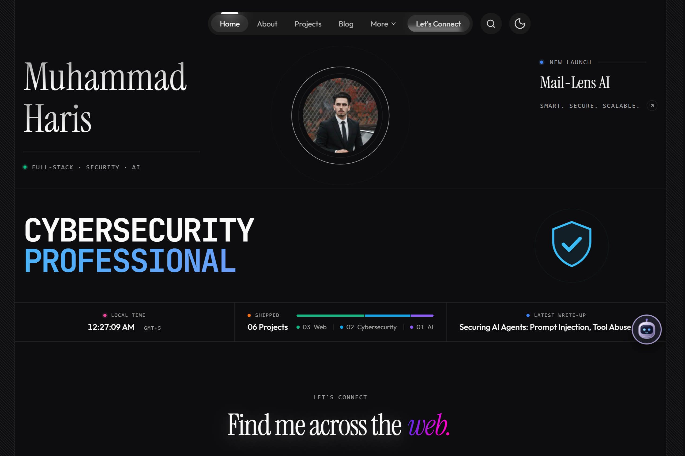

  

   

  

   

  

    
    
    
    
    
  

  

    
    
    
    
    
  

---

## 👨‍💻 Executive Summary

I am **Muhammad Haris**, a **BS Information Technology graduate (2022–2026, 3.49 / 4.00 CGPA)** from the **University of Malakand**, operating at the intersection of **full-stack software architecture**, **defensive cybersecurity / SOC tooling**, and **applied AI/ML engineering**.

I approach software engineering with an adversary-first mindset: **a developer who knows how systems break is the best architect to build systems that don't.** Whether architecting database-per-tenant hospital platforms, streaming Suricata intrusion telemetry over WebSockets, or building sub-15ms explainable NLP threat classifiers, every system I ship is hardened by design, verified with automated test suites, and documented for zero technical debt.

 

<table width="100%">
  <tr>
    <td width="50%" valign="top">
      <h4>🏆 National IT Merit (Top 15%)</h4>
      
Ranked in the <b>84.6th percentile (Top 15% nationwide)</b> among 33,000+ computing graduates in Pakistan's National Skills Competency Test (NSCT 2026), evaluated across 10 core computer science and engineering disciplines.

    </td>
    <td width="50%" valign="top">
      <h4>🛡️ Cybersecurity Mastery (96%)</h4>
      
Achieved a <b>96% coursework score</b> in Cybersecurity & Defense Operations, paired with hands-on SOC telemetry (Wazuh SIEM), NIDS engineering (Suricata 7, Snort), and an active <b>130+ day streak</b> on TryHackMe defensive labs.

    </td>
  </tr>
  <tr>
    <td width="50%" valign="top">
      <h4>🤖 Applied AI & Explainability (98.64%)</h4>
      
Trained and evaluated a 3-class NLP email threat intelligence system achieving <b>98.64% test accuracy</b> across 3,592 holdout samples with custom hyperplane token attribution and <b>&lt;15ms CPU inference</b>.

    </td>
    <td width="50%" valign="top">
      <h4>✍️ Technical Writing & Architecture</h4>
      
Authored <b>10 comprehensive technical whitepapers</b> analyzing AI agent security, post-quantum cryptography migration (ML-KEM/ML-DSA), RAG reliability, and cloud Zero Trust architectures.

    </td>
  </tr>
</table>

---

## 🚀 Flagship Engineering Projects

### 🛡️ [IntruShield NIDS](https://github.com/harisx404/intrushield-nids) — Autonomous Network Intrusion Detection & SOC Platform

  

> **Autonomous Security Operations Center (SOC) telemetry platform** bridging Suricata 7 deep-packet inspection with an asynchronous FastAPI backend and a Next.js 14 SOC command center over persistent WebSockets.

- **Sub-5ms Telemetry Streaming:** Non-blocking `aiofiles` tailing of Suricata `eve.json` broadcasting structured alert objects directly over WebSockets with zero polling latency.
- **In-Memory Ring Deduplication:** Sliding-window event buffer collapsing repetitive flood alerts (e.g. 250 brute-force attempts into 1 contextual incident) to eliminate analyst alert fatigue.
- **Threat Intelligence Enrichment:** Automatically enriches external threat vectors with MaxMind GeoIP2 country codes, ASN data, and coordinates on ingest.
- **Offensive Attack Validation:** Benchmarked and validated against simulated SYN floods, Nmap sweeps, Hydra SSH brute-force attacks, and Log4j CVE-2021-44228 exploits.
- **Stack:** `Python 3.12` `FastAPI` `Suricata 7.0` `Next.js 14 (App Router)` `WebSockets` `PostgreSQL` `Docker Compose` `Zustand` `Recharts`

  
  &nbsp;
  

---

### 🤖 [Mail-Lens AI (PhishGuard AI)](https://github.com/harisx404/phishguard-ai) — NLP Threat Intelligence & Explainable AI (XAI)

  

> **High-accuracy email threat classification and explainability engine** detecting phishing, social engineering lures, and malicious payloads with instant plain-English attribution. Capstone project for the KPITB AI Fellowship.

- **Empirically Evaluated Accuracy:** Achieved **98.64% test accuracy** and **0.9761 Macro F1** across a held-out test partition of 3,592 unseen emails (99.09% precision on legitimate, 97.95% on phishing, 97.06% on malicious).
- **Domain-Specific Feature Fusion:** Combines 10,000 sublinear TF-IDF n-grams with 20 heuristic cybersecurity signals (Levenshtein typosquatting distance against top brand domains, urgency density, attachment risk).
- **Explainable AI (XAI) Attribution:** Projects feature weights directly onto learned SVM hyperplane coefficients to generate keyword threat attribution chips and diagnostic explanations without black-box SHAP/LIME overhead.
- **Ultra-Fast & Offline:** Operates 100% locally with **&lt;15ms CPU inference** per email with zero telemetry leakage; validated across 71 automated Pytest unit and integration tests.
- **Stack:** `Python 3.10+` `Scikit-Learn` `LinearSVC` `Platt Scaling` `TF-IDF` `NLTK` `Streamlit` `Docker` `Pytest`

  
  &nbsp;
  

---

### 🏥 [MedicaLink HMS](https://github.com/harisx404/MedicaLink-HMS) — Enterprise Multi-Tenant Hospital Management SaaS

  

> **Enterprise-grade healthcare management SaaS** engineered with strict database-per-tenant isolation, real-time clinical synchronization, and a Google Gemini AI clinical documentation copilot.

- **Tenant Isolation:** Enforces physical and logical database-per-tenant separation through dynamic Mongoose connection multiplexing resolved from tenant subdomain headers.
- **Granular Access Control:** Implements 15 distinct hospital roles (Doctors, Nurses, Pharmacists, Lab Techs, Billing, CMOs) across 25+ clinical modules with zero cross-tenant data leakage.
- **Real-Time Clinical Telemetry:** Powers emergency department bed allocation and ICU patient triage queues via Socket.io backed by Redis pub/sub.
- **Clinical AI Copilot:** Embedded Google Gemini 1.5 Flash assistant transforming unstructured doctor consultation notes into formatted SOAP (Subjective, Objective, Assessment, Plan) records.
- **Encrypted Telemedicine:** Built-in WebRTC browser-to-browser encrypted video consultations with virtual waiting rooms.
- **Stack:** `TypeScript Strict` `Turborepo` `React 18` `Vite` `Node.js 20 LTS` `Express 4` `MongoDB Atlas` `Redis` `Socket.io` `Gemini 1.5 Flash` `Tailwind CSS` `shadcn/ui`

  
  &nbsp;
  

---

### 📡 [PacketVision](https://github.com/harisx404/packet-vision-network-sniffer) — Multithreaded Network Packet Sniffer & Protocol Analyzer

  

> **High-performance terminal-based network packet inspection and protocol telemetry engine** built with a decoupled Producer-Consumer multithreaded architecture.

- **Zero-Drop Concurrency:** Decouples raw socket wire capture from console parsing using Python's synchronized `queue.Queue`, preventing socket buffer overflows under heavy bursts.
- **RAM Exhaustion Protection:** Employs `store=False` in Scapy with a bounded FIFO queue, maintaining a flat ~45MB RSS memory profile across 500,000+ continuous packets.
- **Anti-ANSI Injection Defense:** Sanitizes raw network payloads by stripping unprintable ASCII characters and terminal escape codes (`\x1b[...]`), mitigating terminal spoofing vulnerabilities.
- **Multi-Layer Dissection & Forensics:** Deep protocol dissection across Layer 2 through Layer 7 (Ethernet, ARP, IPv4/v6, TCP flag matrix, UDP, ICMP, DNS, HTTP, TLS SNI) with Wireshark `.pcap`, structured JSON, and CSV export.
- **Stack:** `Python 3.12+` `Scapy 2.5+` `Raw Sockets` `Multithreading` `Berkeley Packet Filters (BPF)` `Npcap/libpcap` `Colorama` `Pytest`

  
  &nbsp;
  

---

### 🗺️ [TourMate Malakand](https://tourmate-malakand.vercel.app/) — Regional Tourism & Geospatial Platform

  

> **Premier BSIT Capstone Project at University of Malakand**, defended with highest departmental honors. Solves travel information bottlenecks across the Malakand division with interactive vector mapping and safety telemetry.

- **Geospatial Mapping & Routing:** Interactive Mapbox GL JS vector tile maps featuring GPS spot clusters, driving distance calculations, and turn-by-turn routing with MongoDB `2dsphere` spatial indexing.
- **Emergency Telemetry & Safety:** Direct-dial emergency SOS directory (Rescue 1122, hospitals, tourist police) paired with live destination OpenWeatherMap forecasts.
- **Bandwidth Optimization:** Client-side HTML5 canvas image pre-compression downscaling photo uploads to &lt;400KB WebP payloads, reducing 3G mobile data consumption by **78%**.
- **Defense-in-Depth:** Hardened with Helmet HTTP Content Security Policy, `express-mongo-sanitize` stripping NoSQL injection vectors, XSS filtering, and tiered auth rate limiting.
- **Stack:** `React 18` `Vite` `Node.js 20 LTS` `Express 5` `MongoDB Atlas` `Mongoose` `Mapbox GL JS` `Cloudinary` `Tailwind CSS`

  
  &nbsp;
  
  &nbsp;
  

---

### 🌐 [Harisx404 Engineering Platform (v3.0)](https://harisx404.vercel.app) — Production Portfolio & AI Assistant

  

> **Production engineering and technical publication platform** combining 127 compiled routes, 168 passing automated test suites, a Supabase PostgreSQL backend with 50 migrations, and a streaming RAG AI assistant.

- **Dual-Provider Resilient AI:** Low-latency Server-Sent Events (SSE) chat API running Groq Cloud Qwen 3.8-27b with automatic failover to Google Gemini 2.5 Flash within 4.5 seconds if zero tokens emit.
- **Zero-Trust Edge Security:** Fail-closed edge middleware enforcing RBAC, 50 PostgreSQL Row Level Security (RLS) migrations, and SHA-256 hashed distributed rate limiting.
- **Automated Testing Suite:** 168 automated test specifications covering unit logic, Supabase RLS contracts, and Playwright headless browser E2E test suites with 100% Lighthouse audit scores.
- **Stack:** `Next.js 15 (App Router)` `React 19` `TypeScript Strict` `Supabase PostgreSQL` `Tailwind CSS` `Framer Motion` `TipTap MDX` `Playwright`

  
  &nbsp;
  

---

## 🧰 Technical Arsenal & Skills Matrix

<table>
  <tr>
    <td width="24%"><b>💻 Languages & Core</b></td>
    <td>
      
       
      TypeScript 5 (Strict), JavaScript (ES6+), Python 3.12, C++, SQL, Bash Scripting, HTML5, CSS3
    </td>
  </tr>
  <tr>
    <td><b>🌐 Frontend Architecture</b></td>
    <td>
      
       
      Next.js 15 (App Router, RSC, SSR), React 18/19, Vite, Tailwind CSS 3, Framer Motion, shadcn/ui, Radix UI, Zustand, TipTap MDX, Mapbox GL JS, Recharts
    </td>
  </tr>
  <tr>
    <td><b>⚙️ Backend & Real-Time</b></td>
    <td>
      
       
      Node.js 20 LTS, Express 4/5, FastAPI (Async Python), WebSockets, Socket.io, WebRTC (P2P), RESTful APIs, Turborepo Monorepos
    </td>
  </tr>
  <tr>
    <td><b>🗄️ Databases & Storage</b></td>
    <td>
      
       
      PostgreSQL (50+ migrations), Supabase (Row Level Security), MongoDB Atlas, Mongoose, Redis (Pub/Sub & Caching), SQLite, Cloudinary CDN
    </td>
  </tr>
  <tr>
    <td><b>🛡️ Defensive Security & SOC</b></td>
    <td>
      
      
      
      
      
      
      
      
      
       
      Deep Packet Inspection (DPI), Network Telemetry & Log Correlation, Berkeley Packet Filters (BPF), Packet Dissection, Anti-ANSI Injection, Helmet CSP, RBAC/ABAC, JWT Auth
    </td>
  </tr>
  <tr>
    <td><b>🤖 Applied AI & ML</b></td>
    <td>
      
      
      
      
      
      
      
       
      Scikit-Learn, LinearSVC, Platt Scaling, TF-IDF Vectorization, NLTK Lemmatization, Hyperplane Attribution, Retrieval-Augmented Generation, Prompt Hardening
    </td>
  </tr>
  <tr>
    <td><b>🚀 DevOps, Cloud & QA</b></td>
    <td>
      
       
      Docker & Docker Compose, GitHub Actions CI/CD, Vercel Edge Deployments, Playwright E2E Browser Testing, Pytest, Node.js Test Runner, Zod, Pydantic
    </td>
  </tr>
</table>

---

## 💼 Professional Experience

<table width="100%">
  <tr>
    <td width="50%" valign="top">
      <h4>🌐 Full-Stack Engineer (Freelance)</h4>
      
<b>Self-Employed · Remote Worldwide</b> &nbsp;|&nbsp; <i>2024 — Present</i>

      <ul>
        <li>Architects and ships production web applications using Next.js, TypeScript, Node.js, and Supabase.</li>
        <li>Enforces zero-trust security defaults, OWASP Top 10 mitigations, and role-based access control (RBAC).</li>
        <li>Re-engineered legacy query and caching layers, cutting API response times by 99% for client applications.</li>
        <li>Delivers transparent milestone scoping, weekly velocity reports, and documented handovers.</li>
      </ul>
      
🏷️ <code>Next.js</code> <code>TypeScript</code> <code>Supabase</code> <code>OWASP</code>

    </td>
    <td width="50%" valign="top">
      <h4>🛡️ Open-Source Systems & Security Engineer</h4>
      
<b>GitHub Community · Remote</b> &nbsp;|&nbsp; <i>2026 — Present</i>

      <ul>
        <li>Designs, tests, and publishes open-source defensive security tools and full-stack software platforms.</li>
        <li>Created <b>IntruShield NIDS</b> (real-time Suricata WebSocket platform) and <b>PacketVision</b> (multithreaded sniffer).</li>
        <li>Architected <b>MedicaLink HMS</b> (multi-tenant hospital SaaS) and <b>TourMate Malakand</b>.</li>
        <li>Releases complete architectural diagrams, threat models, and reproducible Docker environments.</li>
      </ul>
      
🏷️ <code>Python</code> <code>FastAPI</code> <code>Suricata</code> <code>Security Tooling</code>

    </td>
  </tr>
  <tr>
    <td width="50%" valign="top">
      <h4>🔒 Cyber Security Intern</h4>
      
<b>CodeAlpha · Remote</b> &nbsp;|&nbsp; <i>Jun 2026 — Jul 2026</i>

      <ul>
        <li>Configured and tuned Network Intrusion Detection Systems using Snort and Suricata for continuous traffic analysis.</li>
        <li>Engineered a custom Python packet sniffer utilizing Scapy and raw sockets for Layer 2–7 payload inspection.</li>
        <li>Conducted manual code audits and automated static code analysis to remediate application vulnerabilities.</li>
        <li>Authored security awareness training modules on social engineering tactics and phishing defense.</li>
      </ul>
      
🏷️ <code>Suricata</code> <code>Snort</code> <code>Scapy</code> <code>AppSec</code>

    </td>
    <td width="50%" valign="top">
      <h4>🖥️ SOC Analyst Intern</h4>
      
<b>Tech Hierarchy · Remote</b> &nbsp;|&nbsp; <i>Mar 2026 — Mar 2026</i>

      <ul>
        <li>Utilized Wazuh SIEM to aggregate logs, monitor endpoints, and correlate events to detect network anomalies.</li>
        <li>Simulated virtual network segmentation architectures in Cisco Packet Tracer with strict subnet isolation.</li>
        <li>Executed hands-on defensive simulations in TryHackMe labs covering traffic forensics and incident triage.</li>
        <li>Practiced active defense strategies, vulnerability identification, and endpoint protection workflows.</li>
      </ul>
      
🏷️ <code>Wazuh SIEM</code> <code>Log Analysis</code> <code>Network Defense</code>

    </td>
  </tr>
</table>

---

## 🎓 Education & Verified Certifications

### 🏛️ Formal Education
**Bachelor of Science in Information Technology (BSIT)** — **University of Malakand (UoM)**, Pakistan  
*Academic Session: 2022 — 2026* &nbsp;|&nbsp; **CGPA: 3.49 / 4.00**  
- **Capstone Honors:** Lead Full-Stack Developer for *TourMate Malakand*, defended with highest department honors.
- **Cybersecurity Excellence:** Scored **96% in Cybersecurity & Defense Operations** coursework.
- **Core Coursework:** Software Engineering, Data Structures & Algorithms, Object-Oriented Programming (C++, Python), Database Systems, Computer Networks & Protocols, Operating Systems, Web Technologies, Artificial Intelligence, and IoT.

 

### 📜 Verified Credentials & Certifications

| Certification / Credential | Issuing Organization | Issued | Credential Verification |
|---|---|:---:|---|
| **CS50's Introduction to Programming with Python** | **Harvard University** | Aug 2026 | [Verify Certificate (09de786b...)](https://cs50.harvard.edu/certificates/09de786b-0b5e-445b-a3bb-e672b623b3ea) |
| **Introduction to Cybersecurity** | **Cisco Networking Academy** | Jun 2026 | [Verify Credly Badge (660327f0...)](https://www.credly.com/badges/660327f0-5dc5-48d1-95e7-e4375d1d3f14/linked_in_profile) |
| **AI Skills Fest 2026** | **Microsoft** | Jun 2026 | [Verify Credly Badge (b21bab8d...)](https://www.credly.com/badges/b21bab8d-85e4-4363-b176-74d4330992e3/linked_in_profile) |
| **AI & Machine Learning (144-Hour Fellowship)** | **KPITB & UET Mardan** | Oct 2026 | [Verify Official Certificate (AI-043)](https://uetmardan.edu.pk/kpitb-certificates/verify.php?token=887cd553618276835b5348b8df6a767e344231d7c27e85ed033f134a5ea4dfd6) |
| **Master Computer Networking** | **Scaler** | Sep 2025 | [Verify Certificate (Scaler Moonshot)](https://moonshot.scaler.com/s/li/Q8CqwmLi0Q) |
| **Hacker Holidays 2026** | **TryHackMe** | 2026 | [View Certificate (THM-T8MNSZKCNH)](https://tryhackme-certificates.s3-eu-west-1.amazonaws.com/THM-T8MNSZKCNH.pdf) |
| **1 Million Prompters** | **Dubai Future Foundation** | 2025 | [View Certificate (v0vHXvZ3ubeN)](https://omp.dub.ai/certificate/v0vHXvZ3ubeN) |
| **Delta 2.0: Full Stack Web Development (MERN)** | **Apna College** | Nov 2023 | *Full-stack engineering & modern web technologies* |

---

## ✍️ Published Technical Whitepapers & Engineering Articles

I author in-depth technical analyses on systems architecture, defensive security, and applied AI. Read all articles on **[harisx404.vercel.app/blog](https://harisx404.vercel.app/blog)**:

- 🛡️ **[Securing AI Agents: Prompt Injection, Tool Abuse, and Least Privilege](https://harisx404.vercel.app/blog/securing-ai-agents)** — 5 practical defense controls: narrow tool definitions, scoped identity tokens, human approval gates, egress control, and audit logging.
- 🔐 **[Post-Quantum Cryptography: What Developers Need to Know Before Migrating](https://harisx404.vercel.app/blog/post-quantum-cryptography-migration)** — Developer guide on NIST standards (ML-KEM, ML-DSA), hybrid classical/PQC key exchanges in TLS, and cryptographic agility.
- 🤖 **[How AI Is Changing the Security Operations Center (SOC)](https://harisx404.vercel.app/blog/ai-security-operations-center)** — Separating AI marketing hype from engineering reality; human-in-the-loop automation during alert triage and correlation.
- 🧠 **[RAG in 2026: What Actually Makes a Retrieval System Reliable?](https://harisx404.vercel.app/blog/reliable-rag)** — Moving beyond naive vector search with structure-aware chunking, dense/sparse hybrid search, and cross-encoder reranking.
- ⚡ **[Small Language Models vs. Large Language Models: When Smaller Makes Sense](https://harisx404.vercel.app/blog/small-vs-large-language-models)** — Latency, cost, and privacy trade-offs with the "route-and-escalate" architectural pattern.
- 🧪 **[How to Evaluate an AI Application Before Calling It Production Ready](https://harisx404.vercel.app/blog/ai-application-evaluation)** — Building evaluation datasets, automated graders, factual grounding vs. hallucination metrics, and CI regression suites.
- 🌐 **[Zero Trust Networking for Modern Cloud Applications](https://harisx404.vercel.app/blog/zero-trust-networking-cloud)** — Architectural implementation of Policy Decision Points (PDP), SPIFFE/SPIRE workload identities, and Kubernetes default-deny rules.
- 📡 **[How AI Workloads Are Changing Modern Network Architecture](https://harisx404.vercel.app/blog/ai-workloads-network-architecture)** — Distributed GPU cluster communications, synchronized all-reduce collectives, tail latency, RoCEv2, and Ultra Ethernet.
- ⚡ **[Next.js 16 in Practice: Cache Components, Instant Navigations, and Modern App Architecture](https://harisx404.vercel.app/blog/nextjs-16-cache-components)** — Deep dive into cache components, the `use cache` directive, Partial Prerendering, and Turbopack production builds.
- 🔒 **[End-to-End Type Safety: Building a Type-Safe MERN Application](https://harisx404.vercel.app/blog/type-safe-mern-typescript)** — Sharing Zod validation schemas between TypeScript React clients and Express 5 backends without redundant interfaces.

---

## 📊 GitHub Telemetry & Activity Stats

  <table border="0" cellspacing="0" cellpadding="0">
    <tr>
      <td align="center" valign="middle">
        
      </td>
      <td align="center" valign="middle">
        
      </td>
    </tr>
  </table>

   

  

    

  

    

  <picture>
    <source media="(prefers-color-scheme: dark)" srcset="https://raw.githubusercontent.com/harisx404/harisx404/output/github-contribution-grid-snake-dark.svg">
    <source media="(prefers-color-scheme: light)" srcset="https://raw.githubusercontent.com/harisx404/harisx404/output/github-contribution-grid-snake.svg">
    
  </picture>

---

## 🤝 Let's Connect & Build Together

I am actively open to **full-time software engineering roles**, **defensive cybersecurity / SOC positions**, **applied AI engineering**, and **high-impact technical contract projects**.

 

<table width="100%">
  <tr>
    <td width="33.3%" align="center" valign="top">
       
      
        
      <b>💼 Professional Network</b>
      
Connect for career opportunities, engineering discussions & industry updates.

    </td>
    <td width="33.3%" align="center" valign="top">
       
      
        
      <b>🌐 Interactive Showcase</b>
      
Explore live project demos, interactive AI assistant & technical blog.

    </td>
    <td width="33.3%" align="center" valign="top">
       
      
        
      <b>📧 Direct Inquiries</b>
      
Fast response for full-time offers, technical consulting & collaborations.

    </td>
  </tr>
  <tr>
    <td width="33.3%" align="center" valign="top">
       
      
        
      <b>🛡️ Hands-on Defense</b>
      
Check out 130+ day streak, rooms completed & defensive lab writeups.

    </td>
    <td width="33.3%" align="center" valign="top">
       
      
        
      <b>🏅 Verified Credentials</b>
      
Explore verified badges from Cisco, Microsoft, and global institutions.

    </td>
    <td width="33.3%" align="center" valign="top">
       
      
        
      <b>💬 Direct Message</b>
      
Reach out directly on WhatsApp for prompt project communications.

    </td>
  </tr>
</table>

 

  
<i>"A developer who understands how systems break is the strongest person to build systems that don't."</i>

  — Muhammad Haris (harisx404)

    

  

